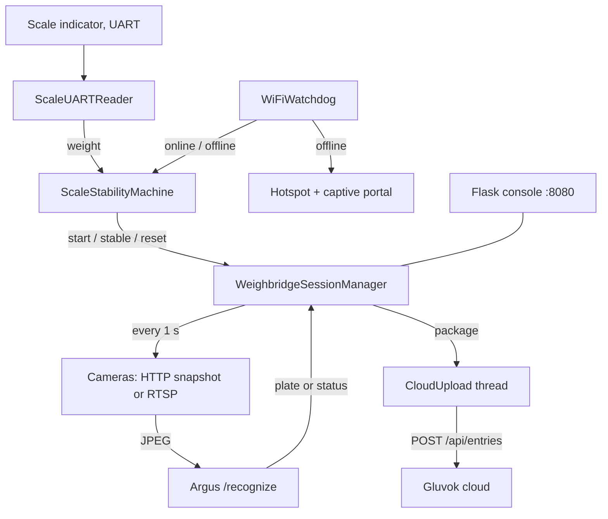

# Hermes Architecture

Hermes runs on a Raspberry Pi 5 at a weighbridge. It reads the scale over UART, captures ANPR and overview camera frames, asks the local Argus service for plate readings, and uploads one entry per weighment to the Gluvok cloud. A Flask console on port 8080 and an nmcli-based hotspot with a captive portal handle diagnostics and Wi-Fi setup.

This document describes what the code does today. For module-level detail see [CODEBASE_REFERENCE.md](CODEBASE_REFERENCE.md).

---

## 1. Data flow

One weighment, in order:

1. The scale reports a weight at or above `min_weight`. The stability machine starts a session, which starts a 1 s ANPR loop: every ANPR camera is grabbed and each frame is sent to Argus in a worker pool.
2. Halfway through the stability window (`stability_duration / 2`), a background thread grabs every camera (ANPR and auxiliary) and compresses each frame in RAM.
3. When the weight has stayed within `stability_tolerance` for `stability_duration` (default 10 s, ±2 kg), the stable weight is locked and a 5 s post-stability timer starts.
4. After 5 s the session is finalized without waiting on slow Argus calls. The plate is the most frequent reading across all samples, or `NO_PLATE_DETECTED`.
5. If Hermes is online, a `CloudUpload_<session_id>` thread posts the package to the cloud. The state machine then ignores the scale until the weight falls below `min_weight` (one upload per truck).

`main.loop()` and the UART thread both call `check_session_progress()`. The phase change inside it is lock-protected, so only one caller receives the package.

### Offline, failed and errored weighments are dropped

There is no spool, outbox or retry queue. Nothing is written to disk for a weighment.

- While the watchdog reports offline, the state machine ignores scale input and aborts any active session.
- If the package completes while offline, it is discarded and a `WEIGHMENT_DISCARDED` event is logged.
- If the upload fails (HTTP error, timeout, network error, exception), it is logged and not retried.

Every dropped weighment increments `cloud.unsent_weighments` in `GET /api/status`. The dashboard shows it on the cloud card, in amber when above 0. The counter is in memory and resets on restart.

### Cloud upload

`POST {GLUVOK_BASE_URL}/api/entries` with HTTP Basic auth (`device_id:device_key`), timeout 20 s, multipart form fields `center_id`, `detected_vehicle_number`, `weight`, and one `file` part per camera (`truck_<label>.jpg`, labels `anpr_1`, `aux_1`, ...). If the server answers 400 with "storage" in the body, the entry is re-posted once without images. HTTP 200/201 is success. Everything else, including 409, is an error recorded as `CLOUD_AUTH_FAILED` (401), `CLOUD_AUTH_FORBIDDEN` (403), `CLOUD_VALIDATION_ERROR` (400) or `CLOUD_UPLOAD_ERROR` (other). On success the LED pulses blue for 10 s.

### Images

HTTP snapshots are used as received. RTSP frames are encoded once at JPEG quality 85. Before upload, every frame is downscaled to at most 1920 px and re-encoded at quality 75 (`src/services/image_compressor.py`). The cloud client sends the bytes as is; it does not compress again.

### ANPR statuses

Each Argus call yields a plate or a status code: `SUCCESS`, `NO_PLATE_DETECTED`, `EMPTY_IMAGE`, `ANPR_BAD_RESPONSE` (HTTP 200 with a non-JSON body), `ANPR_HTTP_<code>`, `ANPR_TIMEOUT`, `ANPR_CONNECTION_ERROR`, `ANPR_REQUEST_ERROR`, `ANPR_WORKER_ERROR`. The session counts every status. The count is in the package as `anpr_status_counts` and is logged as an `ANPR` system event ("Session X statuses: {...}"), so an Argus outage is visible as many non-`SUCCESS` counts and not only as a missing plate.

---

## 2. Threads and supervision

| Thread | Started by | Job |
| :--- | :--- | :--- |
| main | `main.py` | `loop()` every 1 s: supervise, then `check_session_progress()` |
| `ScaleUART` | `ScaleUARTReader.start()` | Read serial, parse weights, drive the stability machine. Reopens the port every 5 s after a loss. |
| `FallbackWebServer` | `start_web_server()` | Flask console, `:8080` |
| `WiFiWatchdog` | `start_wifi_watchdog()` | Connectivity checks every 1 s |
| `ANPRLoop_<id>` | session start | Capture ANPR frames every 1 s, dispatch to the Argus worker pool (2 workers, max 2 in flight) |
| `FleetCapture_<id>` | mid-stability or stable | Capture all cameras and compress |
| `CloudUpload_<id>` | session finalized | Upload one entry |
| `CaptiveHTTP`, `CaptiveDNS` | hotspot start | Captive portal, only while the hotspot is up |

`main.loop()` restarts the UART reader and the watchdog if their threads died. The web server and portal threads are not supervised.

The watchdog is the only code that probes the network (TCP to the Gluvok cloud host first, then 1.1.1.1:53 and 8.8.8.8:53, 1.5 s each). After 5 consecutive failed checks (about 5 s if the link refuses connections, up to about 30 s if it silently drops packets) it calls `notify_network_status(False)`, which updates the stability machine first and the LED second, so an LED fault cannot stop the weighment from going offline. The UART thread reuses that verdict and never probes. The stability machine assumes online until the watchdog says otherwise.

Locks: `ConfigManager`/`RuntimeConfig` (`RLock`), the UART line buffer, the session manager, telemetry (`_events_lock`, `_live_lock`), the Wi-Fi vault, nmcli (`nmcli_lock`, serializes all nmcli calls), `ScaleStabilityMachine` (`RLock`), `ScaleUARTReader._lifecycle_lock` (`RLock`), `_argus_probe_lock` (`Lock`).

---

## 3. Console security

- **Credentials**: `SUPERADMIN_USER` (default `superadmin`) and `SUPERADMIN_PASS`. With `SUPERADMIN_PASS` empty, every login fails.
- **Tokens**: `POST /api/login` returns a random 64-hex token, valid 2 h and renewed on each use. Tokens live in memory and are lost on restart. Send them as `Authorization: Bearer <token>` or `X-Auth-Token`. `POST /api/logout` revokes the token.
- **Login limit**: 5 failed logins per client IP per 60 s, then HTTP 429. Each failure also sleeps 0.5 s. The captive portal `/connect` shares the same limiter.
- **Anonymous `GET /api/status`** returns health only: scale state and weight, Argus online, cloud `configured` and `unsent_weighments`, Wi-Fi `connected` and `hotspot_active`. With a valid token it adds center ID, SSID, config values, latest weighment, error counts and the event log.
- **Headers** on every response: `X-Content-Type-Options: nosniff`, `X-Frame-Options: DENY`, and a Content-Security-Policy that allows only same-origin resources plus inline scripts and styles.
- **No CORS**: no CORS headers are sent.
- **Input**: `serial_port` must match `/dev/ttyAMA*`, `ttyS*`, `ttyUSB*`, `ttyACM*`, `serial0/1` or `serial/by-id/*`. Baud rate must be in a fixed list. Camera URLs must be http, https or rtsp. The dashboard HTML-escapes server-supplied values it renders.
- **Logs** mask `user:pass@` in camera URLs.

---

## 4. Wi-Fi, hotspot and captive portal

Package `src/devices/wifi/` drives NetworkManager through `nmcli` (via `sudo -n` when not root).

- When the watchdog sees 5 failed checks, it starts the emergency hotspot: SSID `hermes`, connection `hermes-hotspot`, gateway `10.42.0.1`, WPA2 passphrase from `HERMES_HOTSPOT_PASS`. If that variable is shorter than 8 characters, the hotspot refuses to start. When connectivity returns, the watchdog stops the hotspot.
- The portal serves a Wi-Fi setup page on port 80 (falls back to 8088 with iptables redirects), a DNS responder that answers every query with the gateway IP (binds UDP 53, else 5354; iptables also redirects interface port 53 to 5354), DHCP option 114 and `/.well-known/captive-portal` (RFC 8908), and maps `hermes.local` and `hermes.config` in `/etc/hosts`.
- `POST /connect` on the portal requires `userid` and `admin_password` (the console credentials) in the JSON body, with the shared per-IP limiter. Bodies over 4096 bytes get 413. On success it joins the network, saves it to the vault and stops the hotspot. On failure the hotspot restarts if it was up. Before joining, it deletes an existing profile only if that profile is a station-mode profile for the same SSID.
- Saved networks are kept in the `wifi_networks` table, password in plain text. `GET /api/wifi/saved` returns SSIDs without passwords and needs a token.
- All nmcli runs hold a lock, and the watchdog pauses itself during hotspot and connect transitions.

---

## 5. Configuration

| Value | Source | Editable in the console |
| :--- | :--- | :--- |
| `device_id`, `device_key`, `center_id`, `min_weight` | `data/client.lic` (Ed25519-signed), else `src/config/client_config.py` defaults | No |
| `anpr_server_url` | `client_config.py` (`http://127.0.0.1:8000/recognize`) | No |
| `serial_port`, `serial_baudrate`, `stability_duration`, `stability_tolerance`, `anpr_camera_urls`, `auxiliary_camera_urls` | `runtime_config` table in `data/hermes.db`, else `client_config.py` | Yes (`POST /api/config`) |
| `wifi_ssid`, `wifi_password` | `runtime_config` | Yes (`POST /api/wifi`) |

`client_config.py` holds no credentials: `DEVICE_ID` and `DEVICE_KEY` are empty. Without a valid license, the cloud card shows `configured: false` and uploads fail with `CLOUD_AUTH_FAILED`. An invalid or tampered license is logged and ignored; Hermes still starts. Defaults without a license: `min_weight` 200 kg, serial `/dev/ttyAMA0` at 2400 baud.

### Required environment

| Variable | Purpose |
| :--- | :--- |
| `SUPERADMIN_PASS` | Console and portal admin password. Required. |
| `HERMES_HOTSPOT_PASS` | Hotspot WPA2 passphrase, 8+ characters. Required. |
| `SUPERADMIN_USER` | Admin user name. Default `superadmin`. |
| `FLASK_SECRET_KEY` | Read by the app factory (default is a fixed string), but nothing in the app uses Flask sessions. |

`main.setup()` calls `require_runtime_secrets()` and exits if either required variable is missing. On the Pi, systemd loads them from `data/hermes.env`. The file is written by `scripts/deploy.py` from the deployer's local environment. For local runs, export them in your shell.

---

## 6. Build and deploy

`scripts/deploy.py --host <user>@<pi-host>`:

1. Requires `SUPERADMIN_PASS` and `HERMES_HOTSPOT_PASS` in the local environment, or exits.
2. Optionally signs `data/client.lic` (`--device-id`, `--device-key`, `--center-id`, `--min-weight`) with `scripts/keygen.py`.
3. Rsyncs the repo to `/opt/hermes`, runs `uv sync`, builds the native binary with Nuitka (`scripts/build.py`), then deletes all `.py` files, `scripts/`, `tests/` and `docs/` on the Pi.
4. Writes `data/hermes.env` (mode 600; required secrets plus `GLUVOK_BASE_URL`/`ANPR_SERVER_TIMEOUT` when set locally) and uploads `data/client.lic`.
5. Creates the system user `hermes` (groups `dialout`, `gpio`, `netdev`), installs `/etc/sudoers.d/hermes` after `visudo -c`, and installs and restarts the `hermes` systemd unit.

The service runs as user `hermes` with `ProtectSystem=strict`, write access limited to `data/`, `/etc/hosts` and the NetworkManager dnsmasq directory, and `CAP_NET_BIND_SERVICE` for port 80. The sudoers drop-in allows only the commands Hermes runs with `sudo -n`: `nmcli`, the portal's `iptables` rules, `fuser -k -9 80/tcp`, and the `/etc/hosts` and dnsmasq file edits.

**Needs a test on a real Pi.** The non-root user, sudoers drop-in and unit hardening have unit tests but have not been run on hardware.

Licensing: `src/config/license.py` verifies the license signature against an embedded public key.

---

## 7. Local storage

`data/hermes.db` (SQLite, WAL) holds two tables: `runtime_config` (key, JSON value) and `wifi_networks`. Weighments, frames and uploads are never stored.

---

## 8. RGB LED

GPIO 17 red, 27 green, 22 blue (via `python-periphery`, mock mode when no GPIO). Green: idle and online. Red: weighment in progress. Yellow: offline. Blue: 10 s pulse after a successful upload.

---

## 9. Code conventions

- Functions stay within 60 lines (NASA JPL Rule 4). One function, `transmit_entry_multipart`, is 64 lines because of its docstring. Tooling does not enforce this.
- CI and the pre-push hook run `ruff check`, `ty check` and `pytest`.
