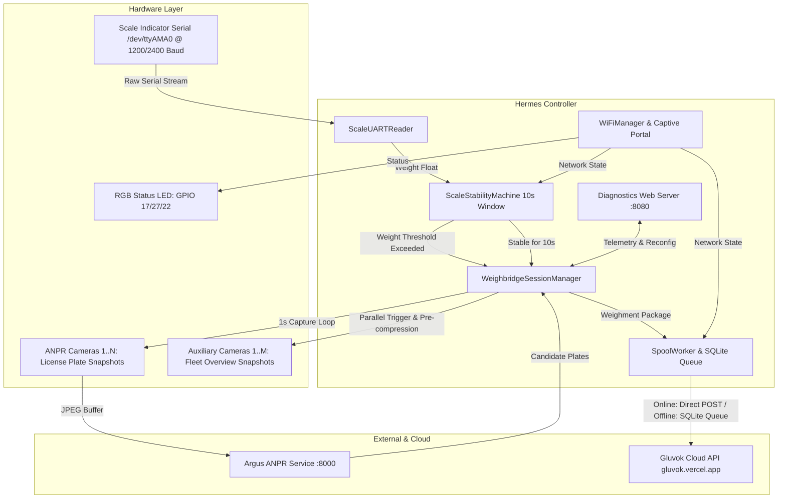

# Hermes System Architecture Specification

`hermes` is an industrial weighbridge integration edge controller designed for Raspberry Pi 5 running Python 3.14 (free-threaded CPython). It coordinates scale serial indicators, multi-camera frame capture, Argus ANPR (Automatic Number Plate Recognition), captive portal Wi-Fi configuration, local SQLite store-and-forward queue durability, and cloud database synchronization via the Gluvok API.

---

## 1. High-Level Architecture



---

## 2. Package Organization

The codebase is organized into 5 primary subsystems under `src/`:

```
hermes/
├── main.py                    # Application entry point, setup, signal handlers, and main loop
├── pyproject.toml             # uv project specification, Python >= 3.14, dependencies
├── uv.lock                    # Locked dependency tree
├── README.md                  # Operational runbook
├── .env.example               # Environment variable template
├── scripts/
│   ├── build.py               # Nuitka binary compilation script
│   ├── deploy.py              # Remote deployment automation
│   ├── keygen.py              # Ed25519 license generator
│   ├── wifi_setup.py          # Standalone Wi-Fi provisioning script
│   └── audit_credentials.py   # Automated static security audit script
├── docs/
│   ├── ARCHITECTURE.md        # Technical architecture specification
│   ├── CODEBASE_REFERENCE.md  # Detailed API and module reference
│   └── plans/                 # Architectural Decision Records and refactoring plans
├── tests/                     # Automated test suite (133 tests, fully sandboxed)
│   ├── conftest.py            # Global test fixtures, hardware mocks, subprocess sandbox
│   ├── test_scale_uart.py     # Serial stream parsing and framing tests
│   ├── test_spool_queue.py    # Store-and-forward SQLite durability tests
│   ├── test_wifi_manager.py   # Wi-Fi connection and watchdog tests
│   └── test_web_server.py     # Diagnostics console REST API tests
└── src/
    ├── config/                # Configuration management and client licensing
    │   ├── __init__.py        # Subsystem exports
    │   ├── client_config.py   # Base client configuration defaults
    │   ├── constants.py       # Hardware, timing, and buffer constants
    │   ├── license.py         # Ed25519 cryptographic license verification
    │   ├── manager.py         # Unified thread-safe ConfigManager
    │   ├── runtime.py         # Runtime configuration mutator
    │   └── store.py           # SQLite runtime overrides persistence
    ├── core/                  # Core domain logic, state machines, and local persistence
    │   ├── __init__.py        # Subsystem exports
    │   ├── db.py              # SQLite database initialization with WAL mode
    │   ├── session.py         # Weighbridge session lifecycle and multi-camera coordination
    │   ├── spool.py           # SQLite FIFO store-and-forward weighment queue
    │   ├── stability.py       # 10s continuous weight stability state machine
    │   ├── telemetry.py       # In-memory circular telemetry and error buffer
    │   └── wifi_vault.py      # SQLite-backed persistent Wi-Fi credentials store
    ├── devices/               # Hardware drivers and interface abstractions
    │   ├── __init__.py        # Subsystem exports
    │   ├── camera.py          # HTTP/RTSP camera frame acquisition and JPEG compression
    │   ├── scale.py           # Scale UART serial reader with framing parser
    │   ├── led/               # RGB LED GPIO driver (python-periphery) and state machine
    │   └── wifi/              # Consolidated NetworkManager Wi-Fi subsystem
    │       ├── __init__.py    # Backward-compatible facade exports
    │       ├── manager.py     # Connection lifecycle, scanning, hotspot, watchdog
    │       ├── portal.py      # DNS interception, HTTP probe redirects, RFC 8910/8908 capport
    │       ├── runner.py      # Process execution wrapper with SIMULATION_STATE
    │       └── state.py       # Thread-safe Wi-Fi state variables
    ├── integrations/          # External microservices and cloud APIs
    │   ├── __init__.py        # Subsystem exports
    │   ├── anpr.py            # Argus ANPR client with consensus plate voting
    │   └── gluvok.py          # Gluvok Cloud API multipart client with Basic Auth
    └── web/                   # Diagnostics and field calibration web console
        ├── __init__.py        # Subsystem exports
        ├── app.py             # Flask application factory
        ├── auth.py            # Superadmin session tokens, brute-force rate limiting
        ├── server.py          # Threaded WSGI server runner on port 8080
        ├── validation.py      # Configuration input validation and sanitization
        ├── blueprints/        # Flask view and REST API routes
        ├── static/            # Offline vendor JS assets (Tailwind CSS, Lucide icons)
        └── templates/         # Embedded Jinja2 HTML templates
```

---

## 3. Subsystem Specifications

### 3.1 Scale Serial Interface (`src/devices/scale.py`)
- Reads raw serial stream from `/dev/ttyAMA0` or USB serial adapters at 1200 or 2400 baud (8N1).
- Runs in a dedicated background daemon thread (`ScaleUART`).
- Employs a 300 ms inter-character silence timer to flush stale buffers.
- Supports both ASCII packet delimiters (`\r`, `\n`, STX `\x02`, ETX `\x03`) and regex pattern matching (`rb"([0-9]{3,6})MN"` and signed floats) to extract numeric weight readings.

### 3.2 Weight Stability State Machine (`src/core/stability.py`)
- Weight threshold: Ignores tare fluctuations below `min_weight` (default `50.0 kg` or `200.0 kg`).
- Continuous stability window: Tracks weight readings over a `stability_duration` (default `10.0 s`) window within `stability_tolerance` (default `±2.0 kg`).
- Transitions:
  - `SCALE_IDLE` -> `SCALE_STABILIZING`: Weight exceeds threshold.
  - `SCALE_STABILIZING` -> `SCALE_STABLE_RECORDED`: Weight remains stable across full duration window.
  - `SCALE_STABLE_RECORDED` -> `SCALE_IDLE`: Platform unloads and weight returns to zero.
- Exactly one weighment package is emitted per physical vehicle passage.

### 3.3 Multi-Camera Capture & Pre-Compression (`src/devices/camera.py`)
- Acquires frames via HTTP snapshot endpoints or single-frame RTSP streams.
- Runs a 1-second capture loop across all active ANPR cameras during `SCALE_STABILIZING`.
- Halfway through the stability window (t = 5s), triggers asynchronous parallel capture of all auxiliary cameras (cabin, cargo, context) and pre-compresses them to JPEG (Quality 85, max 1920px) in RAM using PIL.
- Eliminates finalization latency upon weight confirmation.

### 3.4 ANPR Consensus Voting (`src/integrations/anpr.py`)
- Dispatches JPEG buffers asynchronously to the Argus ANPR REST microservice (`/recognize`).
- Requests are tagged with `session_id`; late responses from previously completed sessions are discarded under lock.
- Employs frequency-based consensus voting across all captured frames to elect the highest-confidence license plate string matching Indian registration patterns (`INDIAN_PLATE_REGEX`).

### 3.5 Store-and-Forward Durability Queue (`src/core/spool.py` & `src/core/db.py`)
- Database: SQLite database (`data/hermes.db`) in WAL mode (`PRAGMA journal_mode = WAL; PRAGMA synchronous = NORMAL;`).
- Schema:
  ```sql
  CREATE TABLE weighment_queue (
      session_id TEXT PRIMARY KEY,
      payload_json TEXT NOT NULL,
      status TEXT DEFAULT 'PENDING',
      retry_count INTEGER DEFAULT 0,
      last_error TEXT,
      created_at TIMESTAMP DEFAULT CURRENT_TIMESTAMP,
      updated_at TIMESTAMP DEFAULT CURRENT_TIMESTAMP
  );
  CREATE INDEX idx_weighment_queue_status ON weighment_queue(status, created_at);
  ```
- Workflow:
  1. When weight stabilizes, if Wi-Fi is offline or the initial direct cloud POST fails, the complete weighment payload is committed to `weighment_queue`.
  2. A dedicated `SpoolWorker` daemon thread executes periodically (every 10s) and checks for network connectivity.
  3. When Wi-Fi is connected, `drain_spool_queue()` transmits pending weighments in FIFO order to the Gluvok Cloud API.
  4. On successful delivery (`HTTP 200/201`), the record is safely dequeued. On failure, `retry_count` is incremented and `last_error` recorded.

### 3.6 Wi-Fi Management & Captive Portal (`src/devices/wifi/`)
- Unified into two primary modules:
  - `manager.py`: Connection lifecycle, network scanning, emergency fallback hotspot, flap-debounced watchdog.
  - `portal.py`: Captive portal implementation with RFC 8910 (DHCP Option 114), RFC 8908 captive API (`/capport`), DNS interception, and captive probe redirects for Android, iOS, Windows, and macOS.
- Simulation Mode: `SIMULATION_STATE["enabled"] = True` bypasses raw system `nmcli` and `iptables` calls, enabling isolated automated testing on developer machines and CI.

---

## 4. Thread Topology & Synchronization Invariants

Under Python 3.14 (free-threaded CPython), threads execute in parallel without GIL serialization. Synchronization is enforced using domain-specific locks:

| Thread Name | Lifecycle | Execution Role | Synchronization Primitive |
| :--- | :--- | :--- | :--- |
| **`ScaleUART`** | Dedicated Daemon | Reads raw serial bytes from `/dev/ttyAMA0` every 50ms | `threading.Lock()` guarding byte buffer |
| **`SpoolWorker`** | Dedicated Daemon | Drains offline SQLite queue every 10s when online | `_db_lock` guarding SQLite connections |
| **`WiFiWatchdog`** | Dedicated Daemon | Evaluates network status every 1.0s, manages AP | `_wifi_lock` guarding Wi-Fi state |
| **`FallbackWebServer`** | Werkzeug Daemon | Serves REST API and diagnostics UI on `:8080` | `_session_lock`, `_login_lock` in `auth.py` |
| **`ANPRLoop_<id>`** | Ephemeral Worker | Periodic 1s ANPR camera capture during session | `threading.Lock()` in `session.py` |
| **`AuxCapture_<id>`** | ThreadPoolWorker | Pre-compresses auxiliary camera snapshots | Thread-safe in-memory byte buffers |

---

## 5. Security & Credential Management

- **Zero Hardcoded Secrets**: Production passwords, camera RTSP URLs, and pre-shared keys are eliminated from source files.
- **Environment Configuration**: Key secrets are loaded from environment variables documented in `.env.example`:
  - `SUPERADMIN_USER` & `SUPERADMIN_PASS`: Authentication for diagnostics web UI.
  - `DEVICE_ID` & `DEVICE_KEY`: Device identity for Gluvok API authentication.
  - `CENTER_ID`: Collection center identifier.
  - `CAMERA_ANPR_1_URL`, `CAMERA_ANPR_2_URL`, `CAMERA_AUX_1_URL`: Camera stream URLs.
- **Brute-Force Protection**: `auth.py` limits failed login attempts to 5 per 60-second sliding window.
- **Client Licensing**: Production devices support Ed25519 signed license files (`data/client.lic`) verified with asymmetric cryptography.
