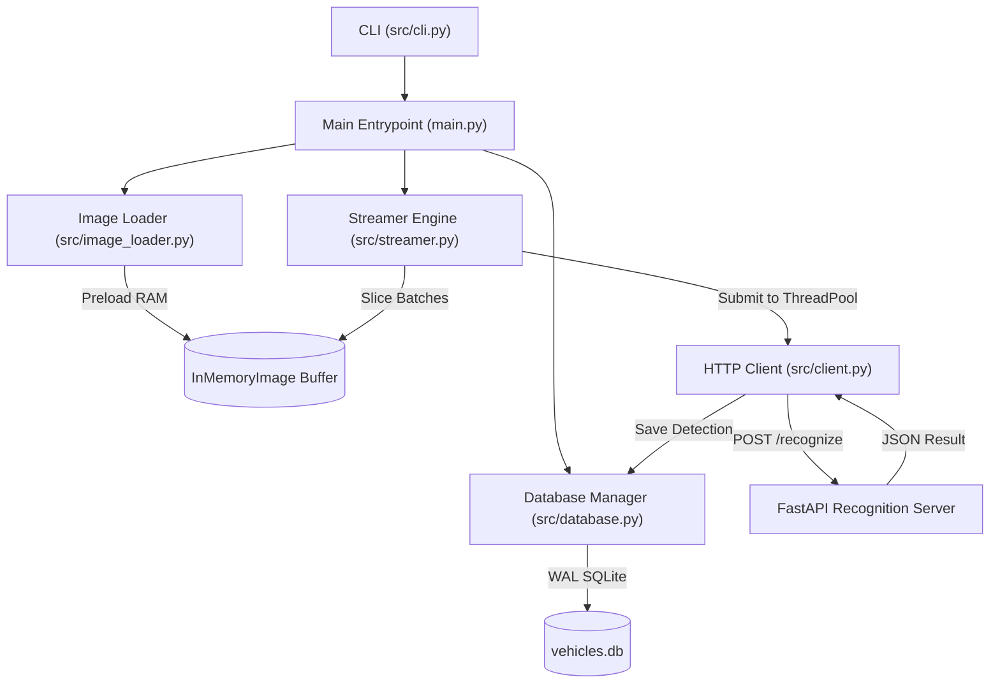

# Hermes Architecture Reference

Hermes is an asynchronous, paced, multithreaded vehicle image streaming client that preloads image assets into memory, streams them in parallel batches to an upstream recognition server, and records detections in a thread-safe SQLite database.

## System Topology & Dataflow

## NASA JPL Rule 4 Adherence (Single Sheet of Paper)

Every file and function is designed to fit on a single printed sheet of standard paper (strictly ≤ 60 lines of code) with single cohesive concerns:

| Component | Responsibility | Lines | Hard Limit |
|:---|:---|:---:|:---:|
| `main.py` | Process entrypoint and signal handling | ~30 | ≤ 60 |
| `src/cli.py` | Command line argument parsing | ~26 | ≤ 60 |
| `src/config.py` | Immutable configuration dataclass | ~15 | ≤ 60 |
| `src/database.py` | Thread-safe SQLite persistence (WAL mode) | ~37 | ≤ 60 |
| `src/image_loader.py` | RAM preloading & natural order sorting | ~41 | ≤ 60 |
| `src/client.py` | Recognition HTTP posting & plate extraction | ~39 | ≤ 60 |
| `src/streamer.py` | Paced batch dispatch & lifecycle control | ~54 | ≤ 60 |

## Concurrency & Thread Safety

1. **Preloading in RAM**: All images are loaded into RAM once as immutable `InMemoryImage` dataclasses, eliminating disk I/O bottlenecks during streaming.
2. **Parallel Multithreaded Dispatch**: `ThreadPoolExecutor` dispatches image recognition requests concurrently, decoupling network latency from scheduling intervals.
3. **Database Concurrency**: `DatabaseManager` synchronizes writes using an internal `threading.Lock` and operates SQLite with `PRAGMA journal_mode=WAL;` for concurrent reading and writing.
4. **Cooperative Cancellation**: Graceful shutdown on `SIGINT` / `SIGTERM` signals coordinated via `threading.Event`.

## Python 3.14 Standards

- **PEP 649 (Deferred Evaluation of Annotations)**: All type hints evaluate lazily; string-quoted forward references and `from __future__ import annotations` are forbidden.
- **PEP 695 (Type Parameter Syntax)**: Type aliases use the native `type` statement (e.g., `type RecognitionPayload = dict[str, Any]`, `type VehicleNumber = str | None`).
- **Modern Collections & Unions**: Native syntax exclusively (`list`, `dict`, `tuple`, `|` union operators).
